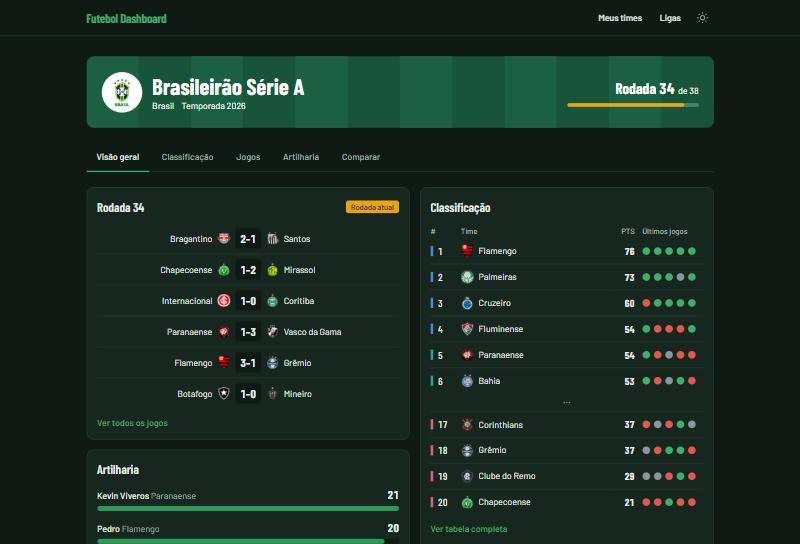
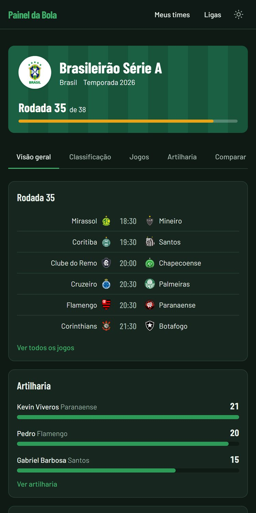
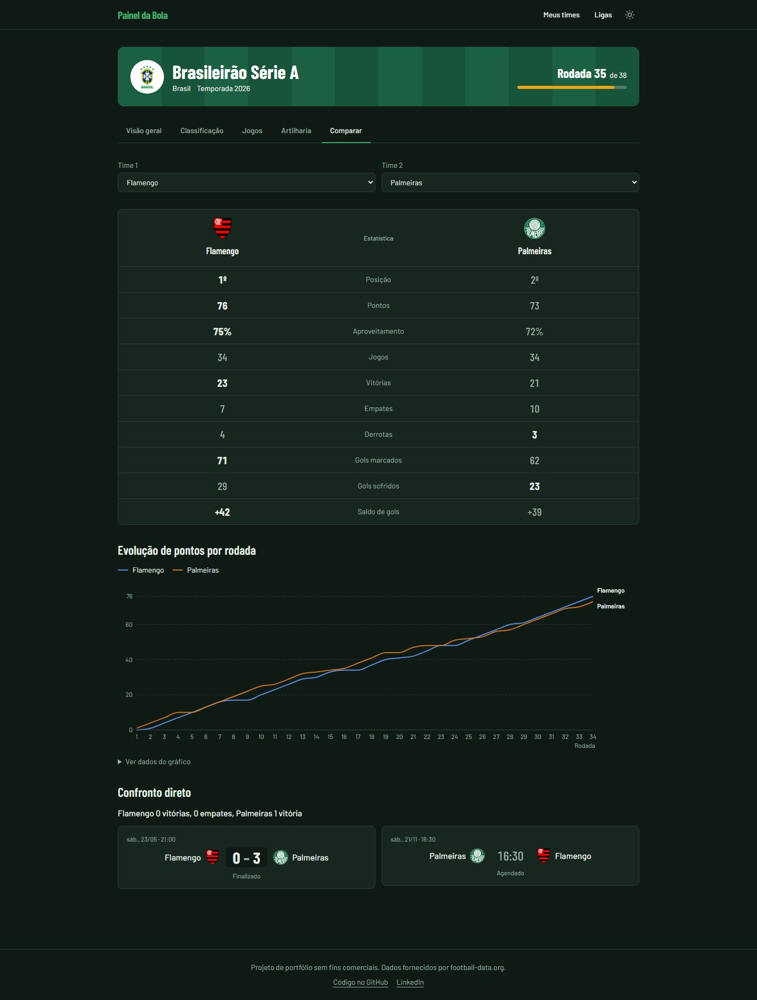
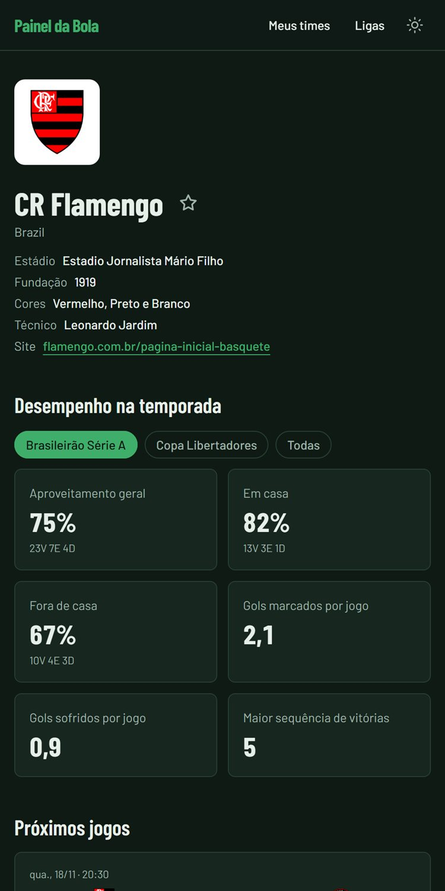

# Painel da Bola

[](https://github.com/takezo-code/painel-da-bola/actions/workflows/ci.yml)

Painel de futebol em Next.js com classificação, jogos, artilharia, comparador de times e times favoritos das principais ligas e copas de clubes, usando dados da football-data.org.

**Acesse:** [futebol-dashboard-mauve.vercel.app](https://futebol-dashboard-mauve.vercel.app/)

| Desktop                                                                               | Celular                                                                              |
| ------------------------------------------------------------------------------------- | ------------------------------------------------------------------------------------ |
|  |  |
|                       |                     |

## Funcionalidades

- **11 competições de clubes:** Brasileirão, Libertadores, Premier League, La Liga, Serie A, Bundesliga, Ligue 1, Champions League, Eredivisie, Primeira Liga e Championship.
- **Jogos de hoje** de todas as ligas na página inicial.
- **Visão geral de cada competição:** progresso da temporada, rodada atual, classificação resumida e artilharia.
- **Classificação** com zonas (Libertadores, rebaixamento etc.), forma dos últimos 5 jogos e grupos da Libertadores.
- **Jogos por rodada ou fase**, agrupados por dia no horário de Brasília, com pênaltis e jogos adiados ou cancelados.
- **Artilharia** com gráfico dos 10 maiores artilheiros.
- **Página do time:** perfil, elenco por posição, próximos jogos, últimos resultados e estatísticas separadas por competição.
- **Comparador:** dois times lado a lado, evolução de pontos rodada a rodada e confronto direto.
- **Meus times:** favoritos salvos no navegador, com último resultado e próximos jogos.
- Modo claro e escuro, layout para celular e acessibilidade (teclado, leitores de tela, contraste AA).

## Tecnologias

Next.js 15 (App Router) · React 19 · TypeScript (strict) · Tailwind CSS 4 · Zod · Recharts · next-themes · Vitest + Testing Library · ESLint + Prettier · GitHub Actions · Vercel

## Decisões técnicas

- **Token protegido no servidor.** Toda chamada à API passa por `src/lib/football-api`, que começa com `import "server-only"`. O navegador nunca fala com a football-data.org: quando um componente do cliente precisa de dados (página "Meus times"), ele chama uma rota interna (`/api/teams/[id]/matches`) que roda no servidor.
- **Cache por tipo de dado** para respeitar o limite gratuito de 10 requisições por minuto: competições e times por 24 h, classificação e artilharia por 1 h, jogos por 10 min (`next.revalidate` no `fetch`). A aba Jogos, a forma recente, o comparador e o progresso da temporada reaproveitam **a mesma chamada** com todos os jogos da temporada.
- **Validação com Zod.** As respostas da API são validadas em tempo de execução. Os schemas foram escritos a partir de respostas reais salvas em `__fixtures__` (capturadas por `pnpm fixtures`), e os tipos TypeScript são derivados deles com `z.infer`.
- **Estatísticas calculadas pelo projeto.** O plano gratuito não traz tudo pronto, então o projeto calcula: forma recente, aproveitamento em casa e fora, médias de gols, maior sequência de vitórias, evolução de pontos, confronto direto e a divisão da Libertadores em grupos. Os testes conferem os cálculos contra a tabela oficial.
- **Erros amigáveis.** Limite de requisições (429) mostra um aviso com "Tentar de novo", 404 leva para "Página não encontrada" e outros erros mostram uma tela de erro com nova tentativa.
- **Testes sem API real.** Mais de 200 testes usam só as fixtures; o CI roda lint, typecheck, testes e build sem nenhum token.

## Como rodar localmente

```bash
git clone https://github.com/takezo-code/painel-da-bola.git
cd painel-da-bola
pnpm install
cp .env.example .env.local
```

Preencha `FOOTBALL_DATA_TOKEN` no `.env.local` com o seu token gratuito da [football-data.org](https://www.football-data.org/) e rode:

```bash
pnpm dev
```

Outros comandos: `pnpm test`, `pnpm lint`, `pnpm typecheck`, `pnpm build` e `pnpm fixtures` (atualiza as respostas reais usadas nos testes).

## Próximos passos

- Login e favoritos salvos em banco de dados.
- Backend separado em NestJS.
- Placar ao vivo e notificações (exige um plano pago da API).

---

Projeto de portfólio sem fins comerciais. Dados fornecidos por football-data.org.
