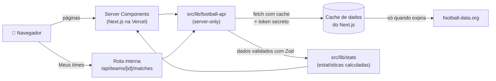

<div align="center">

# ⚽ Painel da Bola

**Classificação, jogos, artilharia, comparador de times e favoritos das principais ligas e copas de clubes do mundo.**

[](https://github.com/takezo-code/painel-da-bola/actions/workflows/ci.yml)


### [🔗 Acessar o site: painel-da-bola.vercel.app](https://painel-da-bola.vercel.app/)


</div>

---

## 📑 Sumário

- [Sobre o projeto](#-sobre-o-projeto)
- [Telas](#-telas)
- [Funcionalidades](#-funcionalidades)
- [Competições disponíveis](#-competições-disponíveis)
- [Tecnologias](#-tecnologias)
- [Arquitetura](#-arquitetura)
- [Decisões técnicas](#-decisões-técnicas)
- [Qualidade e desempenho](#-qualidade-e-desempenho)
- [Estrutura de pastas](#-estrutura-de-pastas)
- [Como rodar localmente](#-como-rodar-localmente)
- [Autor](#-autor)

---

## 💡 Sobre o projeto

O **Painel da Bola** é um projeto de portfólio que reúne, em um só lugar, os dados das 11 maiores competições de clubes do mundo, com cara de site de futebol: tabela com zonas coloridas, jogos agrupados por dia, gráficos de artilharia e de evolução de pontos, página de cada time e uma lista de times favoritos.

Os dados vêm da API gratuita da [football-data.org](https://www.football-data.org/). Como o plano gratuito tem limite de **10 requisições por minuto** e não traz estatísticas prontas, boa parte do trabalho foi:

- **usar cache** para atender muitos visitantes com poucas chamadas;
- **calcular as estatísticas** no próprio projeto (forma recente, aproveitamento, sequências, confronto direto, grupos da Libertadores);
- **proteger o token** da API, que nunca chega ao navegador.

Toda a interface é em português do Brasil, com horários no fuso de Brasília.

---

## 📸 Telas

|                                Visão geral (celular)                                 |                     Página do time (celular)                      |
| :----------------------------------------------------------------------------------: | :---------------------------------------------------------------: |
|  |  |

<p align="center">
  
  <br />
  <em>Comparador: dois times lado a lado, evolução de pontos e confronto direto.</em>
</p>

---

## ✨ Funcionalidades

### 🏠 Página inicial

- **Jogos de hoje** de todas as competições, considerando o dia no horário de Brasília.
- Atalhos para as 11 competições, com os emblemas oficiais.

### 🏆 Competição

Cada competição tem cinco abas:

| Aba               | O que mostra                                                                                                                                                      |
| ----------------- | ----------------------------------------------------------------------------------------------------------------------------------------------------------------- |
| **Visão geral**   | Progresso da temporada, rodada atual, classificação resumida e os principais artilheiros.                                                                         |
| **Classificação** | Tabela completa com zonas (Libertadores, Sul-Americana, rebaixamento etc.), legenda e forma dos últimos 5 jogos. Na Libertadores, a tabela é separada por grupos. |
| **Jogos**         | Jogos por rodada ou por fase (no mata-mata), agrupados por dia, com pênaltis, jogos adiados e cancelados.                                                         |
| **Artilharia**    | Gráfico dos 10 maiores artilheiros e lista com gols, assistências e pênaltis. Jogadores empatados dividem a posição.                                              |
| **Comparar**      | Dois times lado a lado: números da temporada, gráfico da evolução de pontos rodada a rodada e confronto direto.                                                   |

### 👕 Página do time

- Perfil: escudo, estádio, ano de fundação, cores e técnico.
- Elenco separado por posição.
- Próximos jogos e últimos resultados.
- **Estatísticas separadas por competição**: aproveitamento em casa e fora, médias de gols, maior sequência de vitórias e forma recente.

### ⭐ Meus times

- Marque qualquer time como favorito com um clique.
- A página "Meus times" mostra o último resultado e os próximos jogos de cada favorito.
- Os favoritos ficam salvos no navegador e se sincronizam entre abas abertas.

### 🎨 Experiência

- Modo **claro e escuro**.
- Layout pensado primeiro para o **celular**.
- **Acessível:** navegação por teclado, textos para leitores de tela e contraste AA.
- Telas de carregamento e mensagens de erro amigáveis em todas as rotas.

---

## 🌎 Competições disponíveis

| Competição          | País              | Formato                  |
| ------------------- | ----------------- | ------------------------ |
| Brasileirão Série A | 🇧🇷 Brasil         | Pontos corridos          |
| Copa Libertadores   | 🌎 América do Sul | Grupos + mata-mata       |
| Premier League      | 🏴󠁧󠁢󠁥󠁮󠁧󠁿 Inglaterra     | Pontos corridos          |
| Championship        | 🏴󠁧󠁢󠁥󠁮󠁧󠁿 Inglaterra     | Pontos corridos          |
| La Liga             | 🇪🇸 Espanha        | Pontos corridos          |
| Serie A             | 🇮🇹 Itália         | Pontos corridos          |
| Bundesliga          | 🇩🇪 Alemanha       | Pontos corridos          |
| Ligue 1             | 🇫🇷 França         | Pontos corridos          |
| Eredivisie          | 🇳🇱 Holanda        | Pontos corridos          |
| Primeira Liga       | 🇵🇹 Portugal       | Pontos corridos          |
| Champions League    | 🇪🇺 Europa         | Fase de liga + mata-mata |

---

## 🛠 Tecnologias

| Área          | Ferramentas                                                                                  |
| ------------- | -------------------------------------------------------------------------------------------- |
| **Framework** | [Next.js 15](https://nextjs.org/) (App Router, Server Components, Route Handlers) e React 19 |
| **Linguagem** | TypeScript em modo `strict`, sem `any`                                                       |
| **Estilo**    | Tailwind CSS 4, fonte Barlow e `next-themes` para o modo claro e escuro                      |
| **Dados**     | API da football-data.org, validada com [Zod](https://zod.dev/)                               |
| **Gráficos**  | [Recharts](https://recharts.org/), carregado só quando o gráfico aparece na tela             |
| **Testes**    | Vitest + Testing Library (jsdom)                                                             |
| **Qualidade** | ESLint, Prettier (com plugin do Tailwind) e GitHub Actions                                   |
| **Deploy**    | Vercel                                                                                       |

---

## 🧭 Arquitetura



1. O visitante abre uma página. Quem busca os dados é o **servidor**, nunca o navegador.
2. Toda chamada passa por `src/lib/football-api`. Ali ficam o token, o cache e a validação.
3. Se o dado ainda está no cache, a API nem é chamada.
4. A resposta é validada com Zod e transformada em estatísticas por `src/lib/stats`.
5. A página chega pronta ao navegador. Só os gráficos e os favoritos rodam no cliente.

---

## 🧠 Decisões técnicas

### 🔐 Token protegido no servidor

A pasta `src/lib/football-api` começa com `import "server-only"`: se algum componente do navegador tentar importá-la, o build quebra. A página "Meus times" depende do navegador (os favoritos ficam salvos lá), então ela chama uma rota interna, `/api/teams/[id]/matches`, que roda no servidor e só então fala com a API. O token **não** usa o prefixo `NEXT_PUBLIC_` e nunca aparece em log nem no histórico do git.

### ⏱ Cache por tipo de dado

Cada tipo de dado muda num ritmo diferente, então cada um tem seu tempo de cache (`next.revalidate` no `fetch`):

| Dado                         | Tempo de cache |
| ---------------------------- | -------------- |
| Competições, times e elencos | 24 horas       |
| Classificação e artilharia   | 1 hora         |
| Jogos                        | 10 minutos     |

Além disso, a aba Jogos, a forma recente, o comparador e o progresso da temporada **reaproveitam a mesma chamada**, que traz todos os jogos da temporada. Uma única requisição alimenta quatro telas.

### ✅ Validação com Zod a partir de respostas reais

Os schemas não foram escritos de memória: eles saíram de **respostas reais da API**, salvas em `src/lib/football-api/__fixtures__` pelo script `pnpm fixtures`. Os tipos TypeScript são derivados dos schemas com `z.infer`, então o tipo e a validação nunca divergem. Se a API mudar o formato, o erro aparece logo, com uma mensagem clara.

### 📊 Estatísticas calculadas pelo projeto

O plano gratuito não traz estatísticas prontas, então o projeto calcula:

- forma recente (últimos 5 jogos);
- aproveitamento em casa e fora;
- médias de gols marcados e sofridos;
- maior sequência de vitórias;
- evolução de pontos rodada a rodada;
- confronto direto;
- divisão da Libertadores em grupos;
- progresso da temporada e rodada atual.

Os testes conferem esses cálculos contra a tabela oficial que a própria API devolve.

### ⚽ Casos difíceis do futebol

- **Mata-mata:** a API não numera bem as rodadas eliminatórias, então os jogos são agrupados por fase (oitavas, quartas, semi, final).
- **Pênaltis:** o placar da API soma os pênaltis ao resultado. O projeto mostra separados o placar do jogo e o da disputa de pênaltis.
- **Fuso horário:** a API trabalha em UTC. "Jogos de hoje" e o agrupamento por dia usam o dia de Brasília.

### 🧯 Erros amigáveis

| Situação                               | O que o visitante vê                                          |
| -------------------------------------- | ------------------------------------------------------------- |
| Limite de requisições (429)            | Aviso explicando o limite, com o botão "Tentar de novo"       |
| Página ou competição inexistente (404) | Página "não encontrada" com atalho para o início              |
| Qualquer outro erro                    | Tela de erro com nova tentativa, sem derrubar o resto do site |

---

## 🚀 Qualidade e desempenho

### Lighthouse (site em produção)

| Página                   | Desempenho | Acessibilidade | Boas práticas | SEO |
| ------------------------ | :--------: | :------------: | :-----------: | :-: |
| Início (celular)         |     98     |      100       |      100      | 100 |
| Visão geral (celular)    |     98     |      100       |      100      | 100 |
| Página do time (celular) |     96     |      100       |      100      | 100 |
| Comparador (celular)     |     98     |      100       |      100      | 100 |
| Visão geral (desktop)    |    100     |      100       |      100      | 100 |

- Os gráficos são carregados **sob demanda**: o JavaScript inicial das páginas com gráfico caiu de 228 KB para 113 KB.
- Os escudos usam `next/image`, que gera versões otimizadas e no tamanho certo.

### Testes e CI

- **223 testes** em 45 arquivos, cobrindo cálculos, formatação, componentes, favoritos e a rota interna.
- Os testes **nunca chamam a API real**: usam só as respostas salvas em `__fixtures__`.
- A cada push, o GitHub Actions roda `lint`, `typecheck`, `test` e `build`, sem precisar de token.

---

## 📁 Estrutura de pastas

```text
src/
├── app/                         # Rotas (App Router)
│   ├── page.tsx                 # Início + jogos de hoje
│   ├── competicoes/[code]/      # Visão geral, classificacao, jogos, artilharia, comparar
│   ├── times/[id]/              # Página do time
│   ├── meus-times/              # Favoritos
│   └── api/teams/[id]/matches/  # Rota interna usada pelos favoritos
├── components/                  # Componentes por área (standings, matches, team, charts, ui...)
├── hooks/                       # useFavorites, useHydrated
└── lib/
    ├── football-api/            # Único ponto de acesso à API (server-only, cache, Zod)
    │   └── __fixtures__/        # Respostas reais usadas nos testes
    ├── stats/                   # Estatísticas calculadas
    ├── favorites/               # Armazenamento dos favoritos no navegador
    ├── competitions.ts          # As 11 competições e suas zonas
    └── format.ts                # Datas, horários de Brasília e textos
scripts/
└── fetch-fixtures.ts            # Captura respostas reais da API (pnpm fixtures)
```

### Rotas

| Rota                             | Página                                               |
| -------------------------------- | ---------------------------------------------------- |
| `/`                              | Início com os jogos de hoje                          |
| `/competicoes/BSA`               | Visão geral da competição (troque `BSA` pelo código) |
| `/competicoes/BSA/classificacao` | Classificação completa                               |
| `/competicoes/BSA/jogos`         | Jogos por rodada ou fase                             |
| `/competicoes/BSA/artilharia`    | Artilharia                                           |
| `/competicoes/BSA/comparar`      | Comparador de times                                  |
| `/times/[id]`                    | Página de um time (pelo id da API)                   |
| `/meus-times`                    | Times favoritos                                      |

Códigos das competições: `BSA`, `CLI`, `PL`, `ELC`, `PD`, `SA`, `BL1`, `FL1`, `DED`, `PPL` e `CL`.

---

## 💻 Como rodar localmente

### Pré-requisitos

- [Node.js](https://nodejs.org/) 24 ou mais recente
- [pnpm](https://pnpm.io/) (`npm install -g pnpm`)
- Um token gratuito da [football-data.org](https://www.football-data.org/client/register)

### Passo a passo

```bash
git clone https://github.com/takezo-code/painel-da-bola.git
cd painel-da-bola
pnpm install
cp .env.example .env.local
```

Abra o `.env.local` e cole o seu token:

```env
FOOTBALL_DATA_TOKEN=seu_token_aqui
```

Suba o servidor de desenvolvimento:

```bash
pnpm dev
```

Depois, acesse [http://localhost:3000](http://localhost:3000).

### Comandos

| Comando          | O que faz                                                               |
| ---------------- | ----------------------------------------------------------------------- |
| `pnpm dev`       | Servidor de desenvolvimento                                             |
| `pnpm build`     | Build de produção                                                       |
| `pnpm start`     | Roda o build de produção                                                |
| `pnpm test`      | Roda os testes                                                          |
| `pnpm lint`      | Verifica o código com ESLint                                            |
| `pnpm typecheck` | Verifica os tipos com TypeScript                                        |
| `pnpm format`    | Formata o código com Prettier                                           |
| `pnpm fixtures`  | Atualiza as respostas reais da API usadas nos testes (precisa do token) |

---

## 👤 Autor

Feito por **Thales Ribeiro**.

[](https://www.linkedin.com/in/thales-ribeiro-27149a34b/)
[](https://github.com/takezo-code)

---

<p align="center">
  <sub>Projeto de portfólio sem fins comerciais. Dados fornecidos por <a href="https://www.football-data.org/">football-data.org</a>.</sub>
</p>
